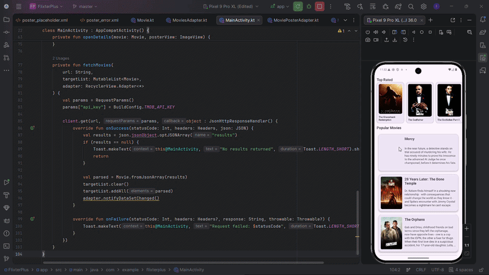

# FlixterPlus

An Android app for browsing popular and top-rated movies from The Movie Database (TMDB). I built it as Project 4 of CodePath's Android course.



## What it does

- Shows popular movies in a vertical list with poster, title, and overview. In landscape the list switches to a two-column grid.
- Shows top-rated movies in a horizontal row of posters above it.
- Tapping a movie opens a details screen with the backdrop, poster, overview, release date, rating, vote count, and popularity.
- The poster slides into the details screen with a shared element transition.
- Images load with Glide and have rounded corners.

## Tech stack

Kotlin, Android SDK (min SDK 24), RecyclerView, View Binding, CodePath's AsyncHttpClient for the TMDB requests, Glide for images.

## How to run it

1. Get a free TMDB API key. TMDB's [getting started guide](https://developer.themoviedb.org/docs/getting-started) explains how.
2. Clone the repo and add this line to `local.properties` in the project root (Android Studio creates the file the first time it opens the project):

   ```properties
   TMDB_API_KEY=your_key
   ```

3. Open the project in Android Studio and run the `app` configuration on an emulator or a device.

`local.properties` is in `.gitignore`, so the key stays on your machine. Without a valid key the app still builds, but the lists stay empty and a "Request failed" message appears.

## What I'd point a reader to

- `MainActivity.kt`: one `fetchMovies` function loads both lists from different endpoints.
- `MainActivity.kt` and `MovieDetailActivity.kt`: the transition name is set per movie and passed to the details screen, so the right poster animates.

## License

    Copyright 2026 Israel Alcantara

    Licensed under the Apache License, Version 2.0 (the "License");
    you may not use this file except in compliance with the License.
    You may obtain a copy of the License at

        http://www.apache.org/licenses/LICENSE-2.0

    Unless required by applicable law or agreed to in writing, software
    distributed under the License is distributed on an "AS IS" BASIS,
    WITHOUT WARRANTIES OR CONDITIONS OF ANY KIND, either express or implied.
    See the License for the specific language governing permissions and
    limitations under the License.
